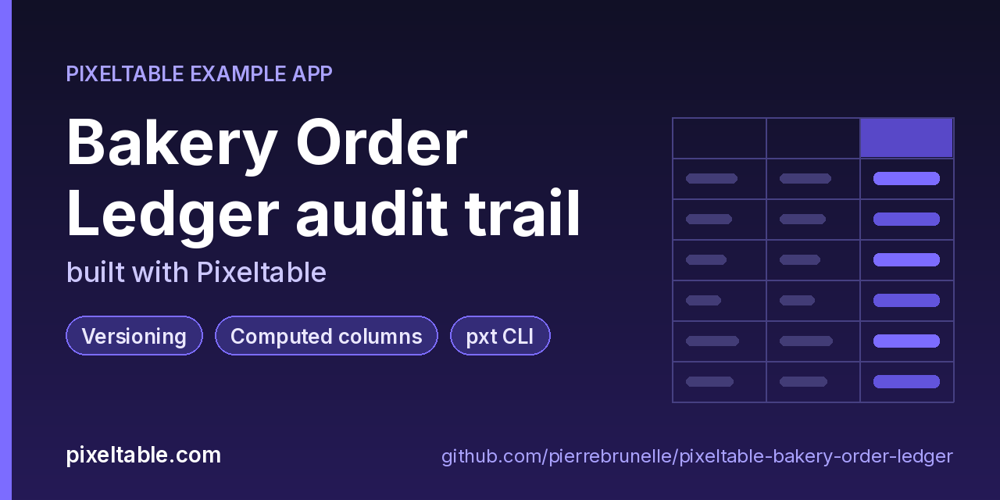

<!-- pixeltable-example-app: 20261022-bakery-order-ledger -->
# Bakery Order Ledger audit trail built with Pixeltable



[](https://codespaces.new/pierrebrunelle/pixeltable-bakery-order-ledger?quickstart=1)
[](https://pixeltable.com)
[](https://pypi.org/project/pixeltable/)
[](https://github.com/pixeltable/pixeltable)
[](LICENSE)

`Orders` holds a bakery's pickup orders (`order_id` primary key, customer, item, quantity, price, placed and pickup timestamps, status). Computed columns derive the order total and size band, and `pixeltable.functions.timestamp` gives the pickup day (`strftime`), hour and ISO weekday; a UDF turns the local pickup hour into the oven slot, and `lead_hours` measures how far ahead the order came in. `RushOrders` is a view of orders picked up within a day. Pixeltable versions every insert, update, delete and schema change automatically, so `audit.py` (argparse, no HTTP router) needs no audit tables of its own: `history` prints the version timeline next to a small `ChangeLog` of who did what, `as-of N` opens `pxt.get_table('bakery/orders:N')` (read-only time travel), `diff A B` compares two versions by primary key, `restore` brings back one order from an older version, `snapshot` freezes a named end-of-day copy with `pxt.create_snapshot`, and `fingerprint` records row counts and revenue for every version so you can check that the whole history survived a Pixeltable upgrade or a move to Pixeltable Cloud. `python audit.py day` simulates a day of edits, including a bulk edit with the wrong filter that is undone with `revert()`.

[Pixeltable](https://pixeltable.com) is open-source, Python-native **multimodal AI data infrastructure**: tables, incremental computed columns, UDFs, indexes and serving in one library, running locally or on Pixeltable Cloud.

> ⭐ **Like this example?** Star [pixeltable/pixeltable](https://github.com/pixeltable/pixeltable) on GitHub. It helps other developers find it.

## What this example shows

- **Incremental computed columns** powered by plain Python UDFs (`@pxt.udf`)
- **`pxt` CLI and local dashboard** for exploring tables and computed columns
- **Pixeltable Cloud lifecycle** from the `pxt` CLI (`db`, `schema`, `service`)
- **B-tree indexes** declared on the model (`__indexes__`) back the lookup queries
- **Versioning**: table history, snapshots and revert for an auditable trail
- **Importable UDF module**: UDFs live in `udfs.py`; tables and queries live in `app.py` (Pixeltable resolves UDFs by module path)
- **`pixeltable.toml`** declares a local database and a **Pixeltable Cloud** database, so the same code deploys with `pxt db update`

## Time travel, snapshots and revert at a glance

| Need | Python | CLI |
|---|---|---|
| Version timeline | `orders.history()` / `orders.get_versions()` | `pxt history bakery/orders -n 10` |
| Read an old version (read-only) | `pxt.get_table('bakery/orders:3')` | `pxt rows bakery/orders:3`, `pxt count bakery/orders:3` |
| Undo the last change | `orders.revert()` | `pxt revert bakery/orders -f` (`-n` = dry run) |
| Keep a named copy | `pxt.create_snapshot('bakery_snapshots/eod', orders)` | `pxt describe bakery_snapshots/eod` |
| Drop tables the schema no longer defines | | `pxt schema prune app.py bakery -n`, then `-f` |

## Notes

- Keep snapshots **outside** the schema directory (`bakery_snapshots/`, not `bakery/snapshots/`): `pxt schema prune app.py bakery` drops every table under `bakery/` that `app.py` does not define, and snapshots count. `pxt schema diff` lists them as `extra (not in schema)` first.
- `revert()` removes the latest version for good; a version that a snapshot references cannot be reverted past.
- The oven-slot UDF takes the pickup **hour** from `pixeltable.functions.timestamp.hour()` instead of the raw timestamp, so it always works in the configured time zone (`pixeltable.time_zone`), whether a row was inserted or updated.
- Changing a computed column's expression in `app.py` and running `pxt schema update` keeps the stored values; run the `pxt recompute bakery/orders slot -f` it prints to refresh them.
- Every command takes `--target pxt://<your-org>:<your-db>/bakery` to run the same audit against Pixeltable Cloud.

## What's inside

| File | What it is |
|------|------------|
| `.devcontainer/devcontainer.json` | GitHub Codespaces / Dev Container config: Python 3.12, installs `requirements.txt` |
| `.github/social-preview.png` | Social preview image (1280x640) |
| `CITATION.cff` | Citation metadata (authors, license, release date, keywords) |
| `app.py` | Tables declared as Python classes and `@pxt.query` functions |
| `audit.py` | Audit CLI for the bakery order ledger: seed, edit, history, time travel, diff, snapshot, revert |
| `pixeltable.toml` | Project config: the local database plus a Pixeltable Cloud database (sizing, deploy excludes) |
| `udfs.py` | Pixeltable UDFs (`@pxt.udf`) in their own importable module, imported by `app.py` |
| `requirements.txt` / `pyproject.toml` | Dependencies (`pixeltable>=0.7.19`) |

**Tables**

| Table | Stored columns | Computed columns |
|-------|---------|------------------|
| `orders` | `order_id`, `customer`, `item`, `qty`, `unit_price`, `placed_at`, `pickup_at`, `status`, `note` | `band`, `pickup_day`, `pickup_hour`, `pickup_weekday`, `lead`, `slot` |
| `change_log` | `orders_version`, `actor`, `action`, `reason`, `at` | `day` |
| `rush_orders` | - | - |

## Run in your browser (GitHub Codespaces)

[](https://codespaces.new/pierrebrunelle/pixeltable-bakery-order-ledger?quickstart=1)

1. Click **Open in GitHub Codespaces** above (or [this link](https://codespaces.new/pierrebrunelle/pixeltable-bakery-order-ledger?quickstart=1)). The dev container installs Python 3.12 and `pixeltable>=0.7.19` from `requirements.txt`.
2. In the codespace terminal, create the tables, seed them and run the app:

   ```bash
   pxt schema update app.py bakery
   pxt schema update app.py bakery             # Orders, ChangeLog and the RushOrders view
   python audit.py seed                        # 12 orders (version 1)
   python audit.py day                         # 6 edits, one version each; a bad bulk edit is reverted
   python audit.py history                     # version timeline + who changed what
   python audit.py as-of 2                     # the ledger exactly as it was at version 2
   python audit.py diff 1 6                    # what changed between versions 1 and 6, by order_id
   python audit.py restore ord-0007 5          # bring back the order deleted in version 6
   python audit.py snapshot eod-2026-10-22     # named end-of-day copy in bakery_snapshots/
   python audit.py fingerprint --out before.json   # then upgrade pixeltable and run --against before.json
   ```


## Quickstart

Requires Python 3.11+ and `pixeltable>=0.7.19`.

```bash
git clone https://github.com/pierrebrunelle/pixeltable-bakery-order-ledger.git
cd pixeltable-bakery-order-ledger
python -m venv .venv && source .venv/bin/activate
pip install -r requirements.txt

# Create the tables in a local catalog directory named `bakery`
pxt schema update app.py bakery

pxt schema update app.py bakery             # Orders, ChangeLog and the RushOrders view
python audit.py seed                        # 12 orders (version 1)
python audit.py day                         # 6 edits, one version each; a bad bulk edit is reverted
python audit.py history                     # version timeline + who changed what
python audit.py as-of 2                     # the ledger exactly as it was at version 2
python audit.py diff 1 6                    # what changed between versions 1 and 6, by order_id
python audit.py restore ord-0007 5          # bring back the order deleted in version 6
python audit.py snapshot eod-2026-10-22     # named end-of-day copy in bakery_snapshots/
python audit.py fingerprint --out before.json   # then upgrade pixeltable and run --against before.json
```

## Deploy to Pixeltable Cloud

The same `app.py` runs on [Pixeltable Cloud](https://pixeltable.com). Sign in (or get a free trial database with `pxt new`), point the second database entry in `pixeltable.toml` at your own database, then deploy:

```bash
pxt login                       # or: export PIXELTABLE_API_KEY=<your-api-key>
# edit pixeltable.toml: name = 'pxt://<your-org>:<your-db>'
pxt db update pxt://<your-org>:<your-db>                 # build the image and upload the project
pxt schema update app.py pxt://<your-org>:<your-db>/bakery   # create the tables in the hosted database
```

Keep keys in environment variables or `pxt secret set`, never in code.

## Code walkthrough

**1. Business logic is plain Python, in `udfs.py`.** A `@pxt.udf` function can be used as a column expression. Pixeltable records UDFs by module path (`udfs.lead_hours`), so they live in their own importable module rather than inline in the app: the daemon, serving workers and Pixeltable Cloud import it again by that path.

```python
# udfs.py
@pxt.udf
def lead_hours(placed_at: datetime.datetime, pickup_at: datetime.datetime) -> float:
    """Hours between placing the order and picking it up."""
    return round((pickup_at - placed_at).total_seconds() / 3600.0, 2)
```

**2. Tables are Python classes (`app.py`).** Annotated attributes are stored columns; attributes assigned an expression are **computed columns** (`band`, `pickup_day`, `pickup_hour`, `pickup_weekday`, `lead`, `slot`), evaluated incrementally on every insert or update and recomputed when their inputs change. Indexes live next to the columns.

```python
# app.py
class Orders(TableModel, name='orders'):
    """One customer order. Every change to it is a new table version."""

    order_id = pxt.Column(type=pxt.String, primary_key=True)
    customer: pxt.String
    item: pxt.String
    qty: pxt.Int
    unit_price: pxt.Float
    placed_at: pxt.Timestamp
    pickup_at: pxt.Timestamp
    status: pxt.String
    note: pxt.String | None

    total = qty * unit_price
    band = price_band(total)
    pickup_day = pxtf.timestamp.strftime(pickup_at, '%a %Y-%m-%d')
    pickup_hour = pxtf.timestamp.hour(pickup_at)
    pickup_weekday = pxtf.timestamp.isoweekday(pickup_at)
    lead = lead_hours(placed_at, pickup_at)
    slot = oven_slot(pickup_hour)

    __indexes__ = [pxt.BtreeIndex(status), pxt.BtreeIndex(pickup_at)]
```

**3. Queries are functions (`app.py`).** `@pxt.query` wraps a Pixeltable query so it can be called from Python or exposed as a route:

```python
# app.py
@pxt.query
def orders_for_pickup_day(day: str):
    """Open orders for one pickup day (format 'Thu 2026-10-22'), earliest first."""
    return (
        Orders.where((Orders.pickup_day == day) & (Orders.status != 'cancelled'))
        .order_by(Orders.pickup_at)
        .select(Orders.order_id, Orders.customer, Orders.item, Orders.qty, Orders.slot, Orders.status)
    )
```

## Learn more

- 🌐 Website: https://pixeltable.com
- 📚 Docs: https://docs.pixeltable.com
- 💻 Source: https://github.com/pixeltable/pixeltable (⭐ star it if Pixeltable is useful to you)
- 📦 PyPI: https://pypi.org/project/pixeltable/
- 🧩 More example apps: https://pierrebrunelle.github.io/awesome-pixeltable-apps/

**[More Pixeltable example apps →](https://pierrebrunelle.github.io/awesome-pixeltable-apps/)**

---

<sub>Built as part of a daily series of Pixeltable example apps · Pixeltable 0.7.19 · Python, incremental computed columns · Licensed under Apache-2.0.</sub>
